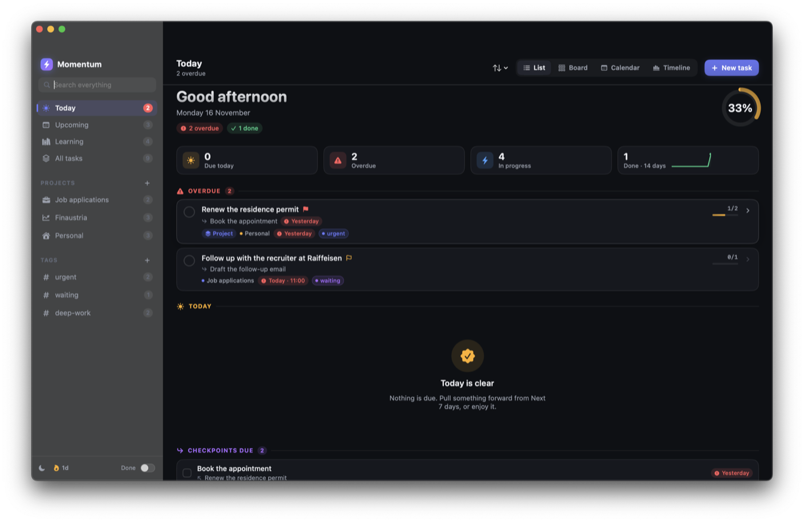
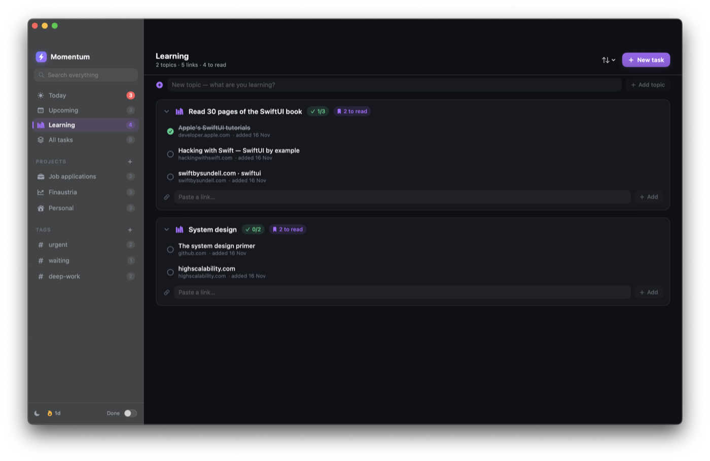
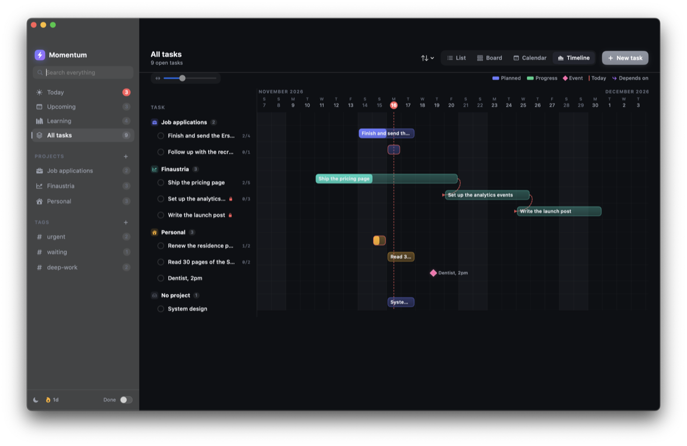
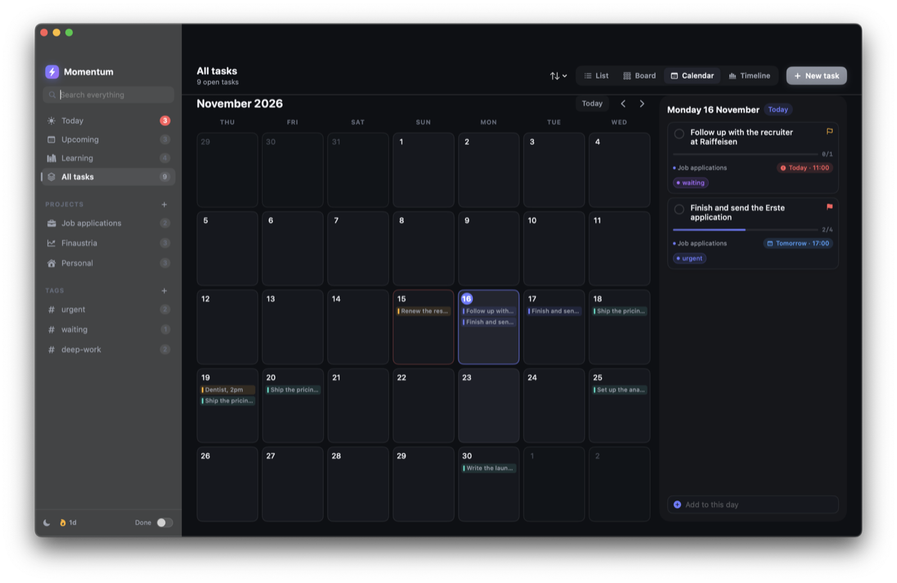
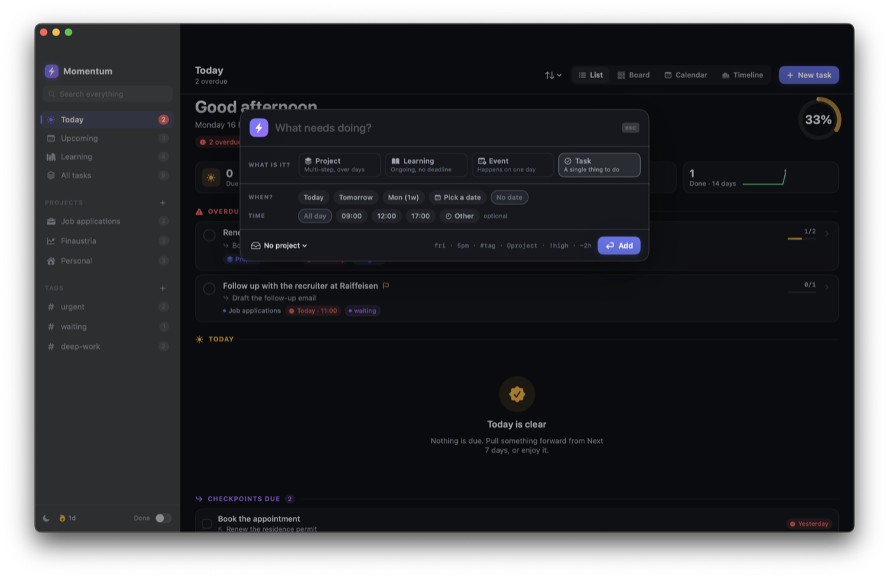

# Momentum

A native macOS personal manager for people running several things at once — built around one
problem: *things get forgotten, and deadlines slip past.*

Tasks break into checkpoints, every deadline is visible before it bites, and the same data shows
up as a list, a board, a calendar or a Gantt timeline depending on what you need to see.



---

## Why it exists

Most task apps are a place to write things down. The writing down was never the hard part — the
hard part is *noticing in time*. So the design pushes everything toward that:

- The home screen opens on what's **overdue**, what's **due today**, and what's **coming**
- A **menu bar counter** shows the number without you opening anything
- **Notifications** arrive the evening before, the morning of, and an hour before a timed deadline
- A **system-wide hotkey** captures a task in two seconds, from whatever app you're in, so it
  never gets lost in the gap between thinking of it and writing it down

---

## Install

**Requirements:** macOS 13 (Ventura) or later. No Xcode needed — just the Command Line Tools.

If you don't have them yet:

```bash
xcode-select --install
```

Then clone and build:

```bash
git clone https://github.com/Piziota/Momentum.git
cd Momentum
./build.sh
```

That compiles the app, generates its icon, ad-hoc signs it, and installs it to
`/Applications/Momentum.app`. If a copy is already running it's quit, replaced and relaunched.
The install only runs when the build succeeded, so a broken compile can never replace a working
app. The whole thing takes about a minute on a first run.

To build without touching the installed copy:

```bash
./build.sh --no-install
```

### After installing — three one-time steps

1. **First launch.** macOS may say the app is from an unidentified developer, because it's signed
   for your machine rather than notarized by Apple. Right-click `Momentum.app` → **Open** →
   **Open**. It only asks once.

2. **Allow notifications** when prompted. Decline and the app can't remind you of anything, which
   removes most of the point.

3. **Start it at login** — **System Settings → General → Login Items → +** → pick Momentum.
   The menu bar counter and the global hotkey only work while it's running.

### Uninstalling

Delete `/Applications/Momentum.app`. Your tasks live in
`~/Library/Application Support/Momentum/`, so remove that folder too if you want them gone.

---

## What it does

### Categories

Every new task asks what kind of thing it is, and the answer changes how it behaves:

| Category | Means | What it does |
|---|---|---|
| **Project** | Multi-step, over days | Gets a start and a due date, draws as a bar on the timeline |
| **Learning** | Ongoing, no deadline | Starts as in-progress, no deadline pressure |
| **Event** | Happens on one day | Date only, no span — a diamond milestone on the timeline |
| **Task** | A single thing to do | Plain, just a due date if you gave one |

The capture box pre-selects a guess — a time of day suggests an Event, words like *learn*, *read*
or *course* suggest Learning, a long estimate suggests a Project — and you click another if it
guessed wrong.

### Learning

A shelf for the things you are learning, separate from the task list — because
resources pile up over months and are not things to tick off by Friday.

Each topic holds the links you have collected under it: articles, videos, docs,
repos. Paste a URL and it files itself, taking its title from the page address
if you do not give one. Type a label after the URL and that becomes the title,
so one line is enough:

```
https://github.com/donnemartin/system-design-primer  The primer
```

Links can be marked read, renamed, copied, opened in your browser or removed.
Each topic shows how many you have worked through and how many are still
waiting, and the sidebar carries the unread count. Searching looks inside the
links as well as the topic names, so a half-remembered domain is enough to find
something again.

Anything captured as a **Learning** category lands here, and every task has a
**Links** tab in the inspector — so a project can collect resources too, and
they show up on the shelf alongside the topics.



### Bright and dark

Two full themes, not one palette dimmed: every colour is defined twice, and the
app picks the set that matches the appearance it is drawn in.

| | |
|---|---|
| **Match System** | follows macOS, flipping with it at sunset if you use Auto |
| **Bright** | stays light whatever the system is doing |
| **Dark** | stays dark whatever the system is doing |

Switch it from the icon in the bottom-left corner of the sidebar, from
**Momentum → Appearance**, or with **⌃⌘T** to flip straight between bright and
dark. The choice is remembered, and it carries the window chrome, the menus and
the blurred backdrops with it rather than just recolouring the content.

### Structure

- **Projects → Tasks → Checkpoints**, where each checkpoint can carry its own date
- **Pages** attached to any task — Markdown with live preview, for notes, research and drafts
- **Tags**, colour-coded, shared across projects — add one with the **+** beside
  TAGS in the sidebar, or just type `#name` while capturing
- **Custom fields** per project: text, number, link, date or dropdown
- **Dependencies** — "this can't start until that's done", with cycles rejected automatically

Task progress is derived from checkpoints rather than typed in: three of five done is 60%, and
that number drives the progress bars and the fill on the Gantt bars.

### Four views over the same data

| View | What it gives you |
|---|---|
| **List** | Today's screen: overdue, due today, checkpoints due, in progress, next 7 days |
| **Board** | Kanban by status, drag cards between columns |
| **Calendar** | Month grid — drag a task to another day to reschedule it |
| **Timeline** | Gantt — drag bars to move, drag edges to resize, dependency arrows, today line |



The timeline turns a dependency arrow red and dashed when the prerequisite finishes *after* the
task depending on it is due — the plan contradicting itself, visible at a glance.



### Capture

Press **⌃⌥Space** from any app. One line gets parsed into a structured task:

```
Send CV to Erste fri 5pm #jobs @finaustria !high ~2h
```



| Pattern | Meaning |
|---|---|
| `today` `tomorrow` `tonight` `eod` `eow` | relative dates |
| `mon`…`sun`, `next tue`, `next week` | weekdays |
| `in 3 days`, `in 2 weeks` | offsets |
| `12 dec`, `dec 12`, `12/06` | explicit dates |
| `5pm`, `17:30`, `noon` | times |
| `#tag` | tag, created if new |
| `@project` | project, matched by prefix |
| `!high` `!med` `!low` (or `p1` `p2` `p3`) | priority |
| `~2h` `~90m` | time estimate |

A strip under the field shows what it understood before you commit. The same parser runs in the
checkpoint field, so typing "Proofread fri" dates the checkpoint.

**You don't have to type the date.** The capture box also asks outright, with a **When?** row
(Today / Tomorrow / a week out / any date from a calendar / No date) and a separate **Time** row
(All day / 09:00 / 12:00 / 17:00 / any other time). **Time is always optional** — "All day" gives
a task a date with no clock attached, and it simply shows as due that day.

Typing and picking stay in sync: write "fri 5pm" and the chips light up to match; click a chip
and it overrides whatever you typed. Leading words that only introduced a date are dropped, so
"Data Viz exam on 20 Nov" becomes a task called *Data Viz exam*, not *Data Viz exam on*.

The hotkey is configurable under **Momentum → Global Capture Hotkey** (⌃⌥Space, ⌃⌥N, ⌃⇧Space,
⌥Space, or Off). It uses Carbon hotkey registration, so it needs **no Accessibility permission** —
but the app has to be running.

---

## Keyboard

| | |
|---|---|
| **⌃⌥Space** | **Capture from any app** (system-wide) |
| ⌘N / ⌘⇧Space | New task / quick capture (inside the app) |
| ⌘1 ⌘2 ⌘3 ⌘4 | Today / Upcoming / Learning / All |
| ⌥⌘L ⌥⌘B ⌥⌘K ⌥⌘G | List / Board / Calendar / Timeline |
| ⌃⌘T | Switch bright / dark |
| ⌘⇧D | Show completed |
| ⌘↵ | Mark selected task done |
| ⌘⌫ | Delete selected task |
| Esc | Close the inspector |

---

## Your data

One JSON file, written atomically. No cloud, no account, no telemetry:

```
~/Library/Application Support/Momentum/store.json
```

**Momentum → Reveal Data File in Finder** opens it. Back it up by copying that file, or put the
folder in iCloud Drive or Dropbox to sync it between Macs.

It sits outside both the source folder and the app bundle, so rebuilding, reinstalling or deleting
the app never touches your tasks.

The app ships with sample data so the views aren't empty on first run.
**Momentum → Remove Sample Data** clears it when you're ready for the real thing.

---

## How it's built

SwiftUI throughout, compiled directly with `swiftc` and bundled by a shell script — no `.xcodeproj`,
no package manager, no third-party dependencies.

```
Sources/
  Model.swift            Project, Item, Checkpoint, Page, Resource, Tag, FieldDef
  Store.swift            state, persistence, queries, mutations, sample data
  Theme.swift            colours (light + dark), theme choice, fonts, motion, dates
  Components.swift       checkboxes, chips, pills, rings, bars, buttons, empty states
  TaskRow.swift          the main list row, with inline checkpoint expansion
  Sidebar.swift          navigation, projects, tags, project editor
  TodayView.swift        the home screen
  MainContent.swift      top bar and grouped list
  BoardView.swift        kanban with drag and drop
  CalendarView.swift     month grid, day panel, drag to reschedule
  LearningView.swift     the learning shelf: topics and their links
  GanttView.swift        timeline: bars, milestones, dependencies, drag and resize
  DetailView.swift       inspector: checkpoints, tags, fields, dependencies
  Pages.swift            page cards and the Markdown renderer
  QuickAdd.swift         the capture palette
  NaturalLanguage.swift  the date/tag/priority parser
  Reminders.swift        notification scheduling
  GlobalHotkey.swift     system-wide hotkey (Carbon) and window focusing
  App.swift              scenes, menu bar extra, menus and shortcuts
tools/MakeIcon.swift     draws the app icon at build time
build.sh                 compile, bundle, icon, sign, install
```

Normal loop: edit something in `Sources/`, run `./build.sh`, try it, commit when it's worth
keeping. `build/` is gitignored because it's regenerated every time.

Environment variables useful while developing: `MOMENTUM_ROUTE`, `MOMENTUM_MODE`,
`MOMENTUM_SELECT` and `MOMENTUM_QUICKADD` pick the starting view, and `MOMENTUM_HOTKEY_TEST=1`
reports whether the global hotkey registered.

---

## Limits, honestly

- **Single user, single Mac.** No sync, no sharing, no server.
- **Storage is a JSON file**, read into memory at launch. Fine for thousands of tasks; if it ever
  felt slow, moving to SQLite touches only `Store.swift`.
- **Ad-hoc signed**, not notarized — hence the right-click on first launch.
- **No recurring tasks yet** ("every Monday"), the most obvious missing piece.
- The global hotkey is released when you quit the app.

### Possible next steps

1. Recurring tasks
2. EventKit, to show Apple or Outlook calendar events alongside tasks
3. An iPhone companion — the model is plain `Codable`, so it would port cleanly
